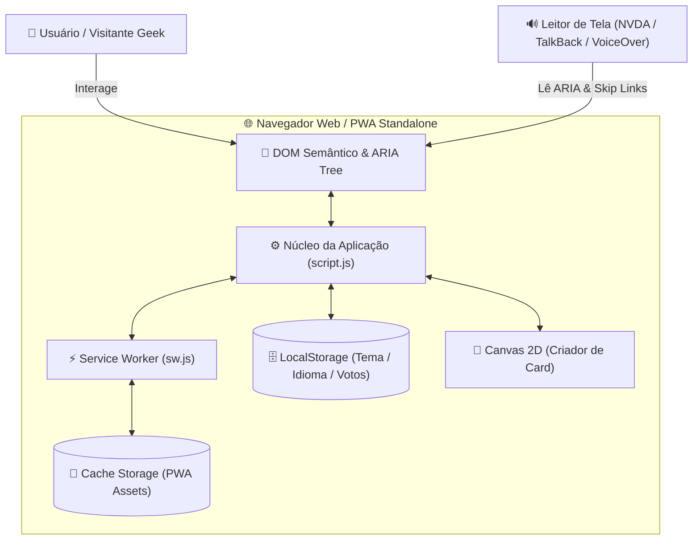
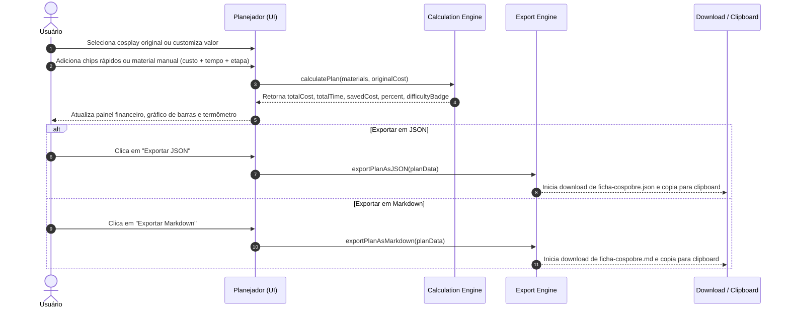
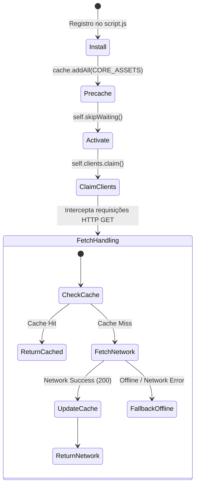

# 🏗️ Arquitetura de Software — Porjeto Cospobre

> Documento oficial de arquitetura e design técnico para o portal **Porjeto Cospobre** (v3.0.0).  
> Foco em performance ultraleve, acessibilidade estrita (WCAG 2.1 AA / WCAG 2.2 AAA), capacidade offline PWA e zero dependências de runtime pesadas.

---

## 1. Visão Geral e Filosofia Arquitetural

O **Porjeto Cospobre** foi concebido sob o paradigma de **Arquitetura Vanilla Moderna e Resiliente**. Em vez de frameworks SPA densos com altos tempos de hidratação (como React, Angular ou Vue), o projeto emprega uma abordagem centrada em padrões nativos da Web (Web Standards):
- **HTML5 Semântico:** Marcação acessível nativa com landmarks WAI-ARIA.
- **CSS3 Moderno:** Design System baseado em Custom Properties (`var(--...)`), CSS Grid e Flexbox com transições aceleradas por hardware.
- **JavaScript ES2022+ Modular:** Lógica desacoplada em funções puras testáveis sem necessidade de compilação ou bundlers obrigatórios.
- **Progressive Web App (PWA):** Manifesto e Service Worker (`sw.js`) com estratégia *Stale-While-Revalidate* para carregamento instantâneo offline.

---

## 2. Diagrama de Contexto do Sistema

---

## 3. Diagrama de Componentes e Módulos

```mermaid
graph TD
    subgraph UI_Components["🧩 Componentes de Interface"]
        Header["Header, Nav & Ações (Tema/Contraste/i18n)"]
        Hero["Hero Section com CTAs"]
        Gallery["Galeria Filtrável com Lightbox Modal"]
        Planner["Planejador de Materiais (Custo & Tempo)"]
        Comparator["Comparador Lado-a-Lado (Expectativa vs Realidade)"]
        CardMaker["Criador de Card Colecionável (Canvas 2D)"]
        Ranking["Ranking Dinâmico & Votação por Categorias"]
        Testimonials["Carrossel Acessível W3C WAI-ARIA"]
        ContestForm["Formulário de Inscrição com Validação em Tempo Real"]
    end

    subgraph Core_Services["🛠️ Serviços e Utilitários (script.js)"]
        I18nService["i18n Service (PT-BR / EN-US)"]
        ThemeManager["Theme & Contrast Manager"]
        PlanEngine["Calculation & Spec Sheet Generator"]
        ExportEngine["JSON & Markdown Exporter"]
        ComparatorEngine["Comparator Presets & Split Slider"]
        RankingEngine["Category Sorter & Rating Engine"]
        CardRenderer["Canvas 2D Card Drawer"]
        A11yAnnouncer["A11y Live Region Announcer"]
    end

    Header --> I18nService
    Header --> ThemeManager
    Planner --> PlanEngine
    Planner --> ExportEngine
    Comparator --> ComparatorEngine
    Ranking --> RankingEngine
    CardMaker --> CardRenderer
    Gallery --> A11yAnnouncer
    ContestForm --> A11yAnnouncer
```

---

## 4. Fluxo de Dados: Planejador de Materiais & Exportação

---

## 5. Ciclo de Vida do Service Worker (Estratégia PWA Offline)

---

## 6. Governança de Estado e Persistência

A aplicação adota gerenciamento de estado transparente e determinístico com persistência resiliente:

| Chave de Armazenamento | Tipo | Propósito | Fallback Padrão |
| :--- | :--- | :--- | :--- |
| `cospobre-theme` | `localStorage` | Preferência de tema visual (`light` / `dark`) | `prefers-color-scheme` do sistema operacional |
| `cospobre-contrast` | `localStorage` | Modo de alto contraste (`high` / `normal`) | `prefers-contrast` do sistema |
| `cospobre-lang` | `localStorage` | Idioma ativo (`pt-BR` / `en-US`) | `pt-BR` |
| `cospobre_community_ratings` | `localStorage` | Cache local das pontuações e notas dos cospobres | Array padrão `defaultContestants` |
| `cospobre_user_votes` | `localStorage` | Registro de notas atribuídas pelo visitante | Objeto vazio `{}` |

---

## 7. Critérios de Acessibilidade (WCAG 2.1 AA / WCAG 2.2 AAA)

1. **Skip Links Múltiplos:** Navegação rápida via teclado para 9 seções essenciais do documento.
2. **ARIA Live Regions:** Anúncios dinâmicos para leitores de tela em filtros, modais, carrossel e troca de idioma.
3. **Alto Contraste Estrito:** Ativação de paleta monocromática de altíssimo contraste com contornos de `2px solid #ffffff` e focos em `#ffff00`.
4. **Armadilha de Foco e Teclado:** Lightbox modal com foco capturado, fechamento por tecla `Escape` e restauração do foco anterior.

---

## 8. Estratégia de Testes Automatizados

Os testes do repositório são executados nativamente via **Node.js Test Runner** (`node --test`), sem dependências externas adicionais:

| Arquivo de Teste | Escopo |
| :--- | :--- |
| `tests/test_structure.js` | DOCTYPE, metatags, links âncoras, unicidade de IDs, integridade dos componentes DOM e acessibilidade. |
| `tests/test_responsive.js` | Validação de metatag viewport e media queries no CSS para múltiplos breakpoints. |
| `tests/test_planner_comparator.js` | Cálculos matemáticos de custo/tempo do planejador, exportadores JSON/Markdown, presets do comparador, ordenação do ranking por 4 categorias técnicas e consistência do dicionário bilíngue i18n. |
| `tests/test_pwa.js` | Conformidade W3C Web App Manifest (`manifest.json`), validação estática de `sw.js` e integridade física de todos os assets cacheados. |
