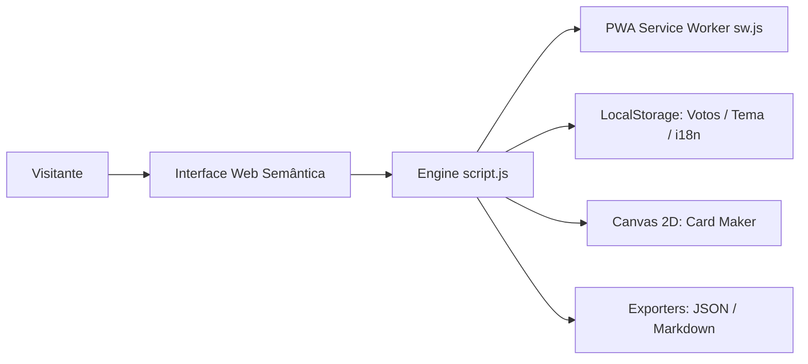

# 🎭 Porjeto Cospobre — A Arte da Gambiarra & Criatividade Extrema

<p align="center">
  
  
  
  
  
  
  
</p>

---

## 📖 Visão Geral

O **Porjeto Cospobre** é uma plataforma web interativa, acessível e bem-humorada dedicada à exaltação da criatividade de baixo custo: a arte de recriar heróis lendários de animes, quadrinhos, jogos e cinema utilizando papelão, fita crepe, garrafas PET e itens recicláveis do dia a dia.

Na versão **3.0.0**, o projeto foi transformado em uma suíte completa de ferramentas para a comunidade cosplay:
1. **📦 Planejador de Materiais com Custo & Tempo:** Cálculo em tempo real de orçamento, tempo estimado de montagem, selos de dificuldade e economia percentual contra produções milionárias de estúdio.
2. **⚖️ Comparador Lado-a-Lado Interativo:** Análise técnica entre a referência oficial e a versão cospobre com proporção visual ajustável por slider e índice de ROI da risada.
3. **🏆 Ranking Dinâmico por Categorias:** Filtros técnicos (Geral, Criatividade, Baixo Custo e Fidelidade), pódio animado com medalhas e sistema de votação popular por estrelas.
4. **📄 Exportação em JSON e Markdown:** Geração instantânea de ficha técnica completa, download de arquivo e cópia para a área de transferência.
5. **📱 Progressive Web App (PWA):** Instalação standalone no celular ou desktop, manifesto W3C e suporte offline robusto via Service Worker.
6. **🌐 Internacionalização Bilíngue (PT/EN):** Alternância instantânea de idioma com persistência em `localStorage`.
7. **🃏 Criador de Card Colecionável:** Canvas 2D customizável com foto local, molduras temáticas e download em PNG de alta resolução.

---

## ⚡ Quick Start (Início Rápido)

### Pré-requisitos
- [Node.js 20+](https://nodejs.org/) instalado para executar os testes e servidor local.

### 1. Clonar e Acessar o Projeto
```bash
git clone https://github.com/seu-usuario/Porjeto-cospobre.git
cd Porjeto-cospobre
```

### 2. Executar a Suíte de Testes Automatizados
```bash
npm test
# ou diretamente via Node.js nativo:
node --test tests/*.js
```

### 3. Iniciar o Servidor Web Local
```bash
npx serve .
# ou via Python:
python -m http.server 8080
```
Abra seu navegador em: `http://localhost:3000` (ou `http://localhost:8080/index.html`).

---

## 🧩 Recursos & Funcionalidades

| Módulo | Descrição Técnica | Status |
| :--- | :--- | :---: |
| **Planejador de Materiais** | Estimativa dinâmica de custo, tempo de confecção em minutos, etiquetagem por etapa e termômetro da gambiarra com badges cómicos. | ✅ 100% |
| **Comparador Visual** | Slider responsivo de divisão visual (`10% / 90%` a `90% / 10%`), presets para Homem de Ferro, Goku, Mulher Maravilha e Batman com métricas de ROI. | ✅ 100% |
| **Exportação Ficha Técnica** | Exportador em formato JSON estruturado e GitHub-Flavored Markdown com download e clipboard. | ✅ 100% |
| **Ranking Dinâmico** | Abas de categorias (Geral, Criatividade, Menor Orçamento, Fidelidade), recálculo de pódio Top 3 e persistência de votos no `localStorage`. | ✅ 100% |
| **Criador de Card (Canvas)** | Renderização em tempo real de card colecionável no elemento `<canvas>`, atributos de batalha RPG e exportação PNG. | ✅ 100% |
| **PWA Completo** | `manifest.json` com ícones vetoriais, `sw.js` com estratégia *Stale-While-Revalidate* e suporte offline integral. | ✅ 100% |
| **i18n Bilíngue** | Dicionários completos para `pt-BR` e `en-US` com atualização em tempo real do DOM e anúncios para leitores de tela. | ✅ 100% |
| **Acessibilidade Inclusiva** | WCAG 2.1 AA e WCAG 2.2 AAA com alternador de Modo de Alto Contraste dedicado, skip links e ARIA Live Regions. | ✅ 100% |

---

## 🏛️ Arquitetura do Projeto

Para especificações detalhadas de design de software, diagramas de sequência e ciclo de vida do Service Worker, consulte o documento [ARCHITECTURE.md](ARCHITECTURE.md).



---

## 🧪 Suíte de Testes Automatizados

O projeto utiliza exclusivamente o **Node.js Test Runner** (`node:test` e `node:assert/strict`), sem dependências externas instaladas:

```bash
node --test tests/*.js
```

### Escopo dos Testes:
- `tests/test_structure.js`: Validação de metatags SEO, landmarks HTML5, âncoras locais sem links quebrados, formulário com validação e acessibilidade.
- `tests/test_responsive.js`: Metatag viewport e media queries responsivas (mobile, tablet, desktop).
- `tests/test_planner_comparator.js`: Cálculos de custo/tempo do planejador, integridade dos presets do comparador, ordenação do ranking nas 4 categorias técnicas, exportação JSON/Markdown e integridade bilíngue do i18n.
- `tests/test_pwa.js`: Validação do manifesto W3C (`manifest.json`), ciclo de vida do `sw.js` e integridade física de todos os assets do cache storage.

---

## 🤝 Como Contribuir

1. Faça um Fork do projeto
2. Crie uma branch para sua funcionalidade: `git checkout -b feature/novo-cospobre`
3. Execute e valide os testes: `npm test`
4. Envie suas alterações: `git commit -m "feat: adiciona novo preset ao comparador"`
5. Abra um Pull Request detalhado

Consulte também os arquivos [CONTRIBUTING.md](CONTRIBUTING.md) e [SECURITY.md](SECURITY.md).

---

## 📄 Licença

Este projeto é distribuído sob os termos da licença **MIT**. Veja o arquivo [LICENSE](LICENSE) para mais detalhes.

---

*Desenvolvido com fita crepe, papelão e amor pela comunidade de Cospobres do Brasil.*
